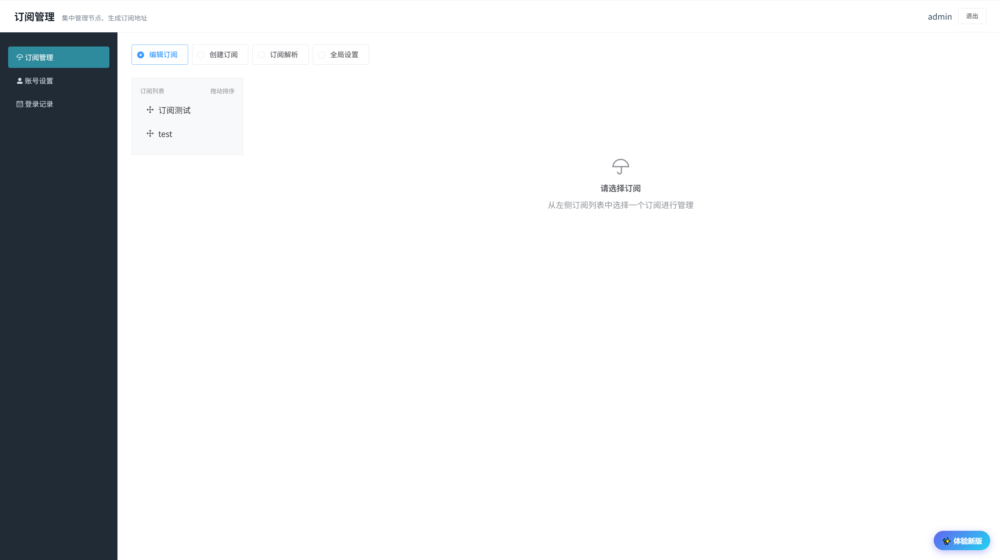
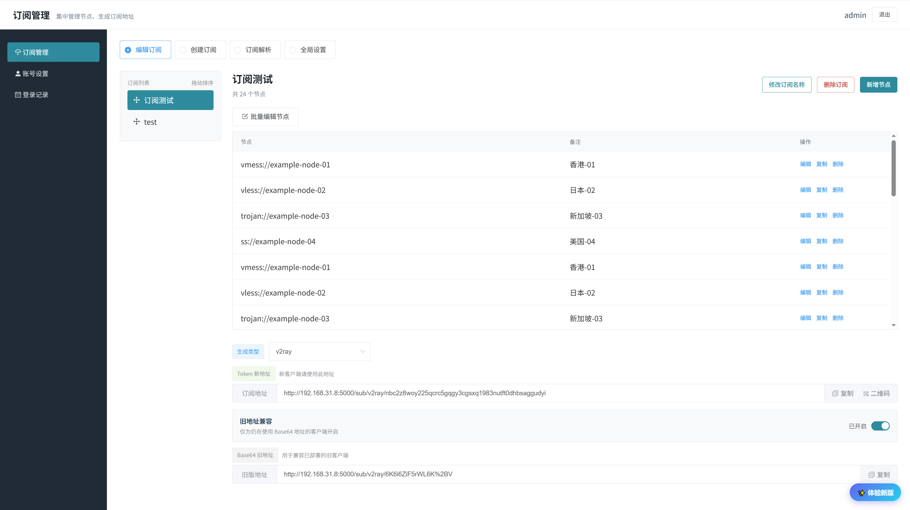
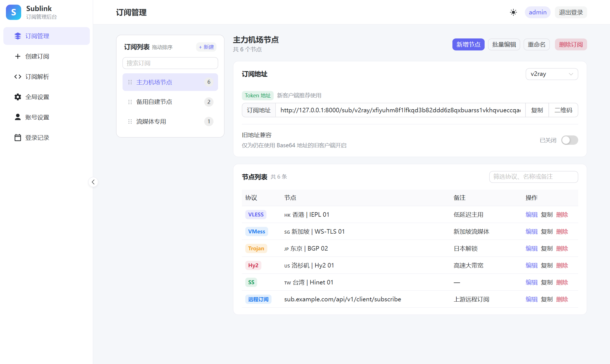
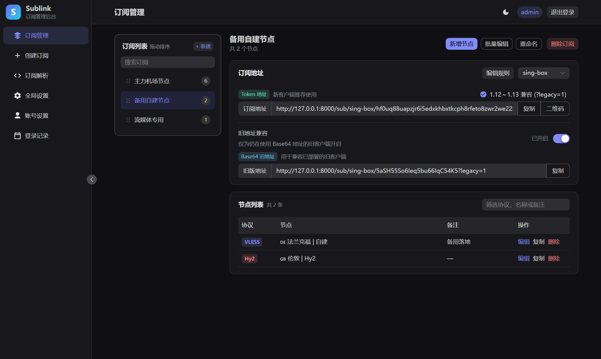

# Sublink v3

Sublink 是一个面向个人使用的自托管订阅管理工具，用于集中保存代理节点，并生成 V2Ray、Clash、Surge 和 sing-box 订阅地址。

> 本项目基于 [jaaksii/sublink](https://github.com/jaaksii/sublink) Fork 并继续维护。
> v3 是本仓库自行维护的版本，并非原项目官方版本。感谢原作者和历史贡献者提供的基础实现。

## 界面预览

| **订阅管理** | **节点与订阅地址** |
| :----: | :----: |
|   |   |


## 全新界面（Beta）

在原有界面基础上新增了一套基于 Vue 3 + Naive UI 的界面，与老版界面隔离共存：

- 老版界面仍在根路径 `/`，顶部导航栏提供「体验新版」入口
- 新版界面在 `/next`，功能与老版一致（订阅管理、创建订阅、订阅解析、全局设置、账号设置、登录记录）
- 支持明暗主题切换、二维码地址、拖动排序、规则配置在线编辑
- 订阅列表默认不选中任何一项，需手动点击查看节点，行为与老版保持一致

| **新版订阅管理** | **新版节点与订阅地址** |
| :----: | :----: |
|   |   |

新版前端源码位于 `web/next`，构建产物输出到 `app/static/next`。本地开发：

```bash
cd web/next
npm install
npm run dev      # 开发调试，访问 http://localhost:5174
npm run build    # 构建产物到 app/static/next，通过 /next 访问
```

## v3 主要变化

- 重构订阅管理界面和节点列表
- 新增基于 Vue 3 + Naive UI 的界面，与老版隔离共存（`/next`）
- 支持拖动调整订阅顺序
- 使用随机 Token 生成订阅地址，避免在地址中直接暴露订阅名称
- 支持按订阅开启旧版 Base64 地址兼容
- 支持远程订阅展开，并在「全局设置」中提供自定义功能（支持回环地址/端口重写、节点名称与国旗修正，以及中转 IPv6 订阅标识自动延续）
- 创建订阅时校验节点有效性，无有效节点时不再误报「创建成功」，并提示跳过的无效节点数量
- 增加数据库迁移和启动时自动升级
- 统一客户端默认订阅名称为 `v3订阅`
- 修复 Windows 下 Clash、Surge 配置文件的编码问题
- 优化前后端本地开发、静态资源构建和 Docker 启动流程

## 功能

- 集中管理多个订阅及其节点
- 创建、编辑、复制和删除节点
- 批量编辑订阅节点
- 调整订阅显示顺序
- 生成 V2Ray、Clash、Surge 和 sing-box 订阅
- 将 HTTP/HTTPS 远程订阅展开到生成结果中
- 通过 Token 地址访问订阅
- 为仍在使用旧地址的客户端单独开启兼容模式
- 管理 Clash、Surge 和 sing-box 基础配置
- 修改管理账号并查看登录记录

支持管理的节点类型包括：

`vless`、`vmess`、`ss`、`ssr`、`trojan`、`hysteria`、`hy2`，以及 HTTP/HTTPS 远程订阅地址。

## 订阅地址

v3 默认生成随机 Token 地址：

```text
http://服务器地址/sub/v2ray/<token>
http://服务器地址/sub/clash/<token>
http://服务器地址/sub/surge/<token>
http://服务器地址/sub/sing-box/<token>
```

sing-box 地址默认输出面向 **sing-box 1.14+** 的远程 Profile（使用 `http_clients` 与 `route.default_http_client`），包含 TUN、DNS、手动选择、自动测速，以及中国大陆和局域网直连规则。支持转换 `vless`、`vmess`、`ss`、`trojan`、`hysteria` 和 `hysteria2` 节点；`SSR` 节点不在 sing-box 支持范围内。

- 若使用 **sing-box 1.12 ～ 1.13** 等旧版内核客户端，可在订阅地址末尾附加 `?legacy=1` 或 `?version=1.12`，服务端将自动兼容输出旧版 `download_detour` 字段。

- Token 地址不会因为修改订阅名称而变化
- 客户端默认显示名称为 `v3订阅`
- 从旧版本升级的订阅默认保留旧地址兼容
- v3 新建的订阅默认关闭旧地址兼容
- 旧地址依赖订阅名称，修改名称后需要重新复制旧地址

Token 相当于订阅访问凭据，请勿公开分享。

## Docker 部署

v3 默认从当前 Git 仓库获取代码并在服务器本地构建镜像，不要使用上游旧版 Docker 镜像。

默认部署约定：

| 项目 | 值 |
| --- | --- |
| 镜像 | `sublink:v3` |
| 容器 | `sublink-v3` |
| 端口映射 | `127.0.0.1:8000:8000`（反代部署）或 `8000:8000` |
| 监听端口 | `8000` |
| 数据目录 | `/root/sublink-v3/db` |
| 仓库目录 | `/root/sublink-v3/release` |

### 1. 准备目录并拉取代码

```bash
mkdir -p /root/sublink-v3/db
mkdir -p /root/sublink-v3/backup
git clone https://github.com/kjqg-cn/sublink.git \
  /root/sublink-v3/release
```

如果已经 Clone 过仓库，不需要重新 Clone 或上传压缩包，更新代码即可：

```bash
cd /root/sublink-v3/release
git pull --ff-only
```

### 2. 构建镜像

> 本项目 Dockerfile 已采用多阶段构建，在构建时会自动完成 Vue 2 老版与 Vue 3 新版双端前端的编译与产物嵌入，无需在开发机提前手动 build 或提交打包产物。

```bash
cd /root/sublink-v3/release
docker build -t sublink:v3 .
```

### 3. 启动容器

```bash
docker run -d --restart always \
  --name sublink-v3 \
  -p 127.0.0.1:8000:8000 \
  -v /root/sublink-v3/db:/app/app/db \
  -e PORT=8000 \
  -e JWT_SECRET_KEY=自定义高强度随机密钥 \
  -e TRUSTED_PROXIES=127.0.0.1,172.16.0.0/12 \
  sublink:v3
```

- `-p 127.0.0.1:8000:8000`：配合本机 Nginx/Caddy 反代时仅绑定回环端口；若无反代直接对外开放，可改为 `-p 8000:8000` 且不要设置 `TRUSTED_PROXIES`。
- `-e JWT_SECRET_KEY=...`：建议设置至少 32 字节的强随机密钥；若未设置，程序会自动生成 256-bit 随机密钥并持久化到 `app/db/.jwt_secret`，多 Worker 与重启均共享该密钥。
- `-e TRUSTED_PROXIES=...`：**经过反向代理时必须配置**（填反代来源 IP 或 Docker 网段，例如 `127.0.0.1,172.16.0.0/12`），否则所有公网访客会共享同一个反代 IP 限流桶（易触发全局 429 锁死），且 Surge `#!MANAGED-CONFIG` 会输出内网 `http://` 地址。仅在明确无公网直连时才可设置 `TRUSTED_PROXY_COUNT`。
- **目录权限说明**：容器默认入口脚本会以 root 自动修正挂载目录 `/app/app/db` 属主为非 root 用户 `sublink`（UID/GID `1000`），随后通过 `gosu` 降权为 `sublink` 运行服务；若使用 `--user 1000:1000` 强制非 root 启动，请提前在宿主机执行 `chown -R 1000:1000 /root/sublink-v3/db`。

也可以使用仓库根目录提供的 `docker-compose.yml` 构建并启动（可通过 `.env` 或环境变量覆盖 `PORT`、`JWT_SECRET_KEY`、`TRUSTED_PROXIES` 等参数）：

```bash
cd /root/sublink-v3/release
docker compose up -d --build
```

容器启动时会自动执行 `upgrade_db.py`：

- 新数据库会自动初始化并生成随机初始密码
- 已有数据库会自动补齐 v3 新增字段和索引
- 不需要手动执行 `flask db upgrade`

### 4. 检查部署结果

```bash
docker ps --filter name=sublink-v3
docker logs --tail 100 sublink-v3
curl -I http://127.0.0.1:8000
```

浏览器访问：

- 若按上方示例绑定 `127.0.0.1:8000:8000`，请在完成下方 Nginx 反向代理后通过你的域名访问（老版 `/`、新版 `/next`）
- 若无反向代理且已将端口映射改为 `-p 8000:8000`，可直接访问 `http://服务器IP:8000`（新版 `http://服务器IP:8000/next`）

### 5. 配置 Nginx

通过 Nginx 对外提供服务时，**务必透传标准反向代理请求头**，并在容器环境变量中配置对应的 `TRUSTED_PROXIES`（例如 `TRUSTED_PROXIES=127.0.0.1,172.16.0.0/12`）：

```nginx
location / {
    proxy_pass http://127.0.0.1:8000;
    proxy_set_header Host $host;
    proxy_set_header X-Real-IP $remote_addr;
    proxy_set_header X-Forwarded-For $proxy_add_x_forwarded_for;
    proxy_set_header X-Forwarded-Proto $scheme;
}
```

检查并重载配置：

```bash
nginx -t
systemctl reload nginx
```

### 6. 常用环境变量

| 变量名 | 默认值 | 说明 |
| --- | --- | --- |
| `PORT` | `5000`（Compose 为 `8000`） | 服务监听端口 |
| `WORKERS` | `4` | Gunicorn Worker 进程数 |
| `JWT_SECRET_KEY` | 自动生成 | JWT 签名密钥（建议 ≥ 32 字节）；未设置时自动持久化至 `app/db/.jwt_secret` |
| `TRUSTED_PROXIES` | 空 | 可信反向代理 IP/CIDR 列表（逗号分隔，如 `127.0.0.1,172.16.0.0/12`） |
| `TRUSTED_PROXY_COUNT` | `0` | 经过的反向代理层数（需配合 `TRUSTED_PROXIES` 或仅内网监听使用） |
| `INIT_ADMIN_USERNAME` | `admin` | 首次建库或重置密码时的初始管理员用户名 |
| `INIT_ADMIN_PASSWORD` | 随机生成 | 首次建库或重置密码时指定的初始密码；留空则生成随机密码并打印到日志 |
| `ALLOW_PRIVATE_SUB_URLS` | `0` | 设为 `1` 允许远程订阅拉取内网/回环地址（默认禁用以防 SSRF） |
| `ALLOW_REMOTE_SUB_ENV_PROXY` | `0` | 设为 `1` 允许远程订阅请求继承宿主机 `HTTP_PROXY`/`HTTPS_PROXY` 代理环境变量 |
| `ALLOW_INSECURE_SUB_SSL` | `0` | 设为 `1` 跳过远程订阅 HTTPS 证书校验（仅建议用于自签名环境） |
| `ENABLE_LOGIN_GEOIP` | `1` | 登录记录是否查询外部 IP 归属地；设为 `0` 可关闭外网查询 |
| `MAX_LOGIN_LOG_ROWS` | `500` | 登录记录表最大保留条数 |
| `LOGIN_RATE_LIMIT_MAX_ATTEMPTS` | `5` | 单个账号窗口期内允许的最大连续登录失败次数 |
| `LOGIN_RATE_LIMIT_IP_MAX_ATTEMPTS` | `20` | 单个来源 IP 窗口期内允许的最大登录失败次数 |
| `LOGIN_RATE_LIMIT_WINDOW` | `300` | 登录失败限流统计窗口时长（秒） |
| `MAX_CONTENT_LENGTH` | `2097152` | 单次请求体最大字节数（默认 2 MiB） |
| `MAX_DECODE_SUB_URLS` | `20` | `/decode_sub` 单次允许解析的最大远程订阅 URL 数量 |
| `CUSTOM_LOOPBACK_PORT` | `443` | 全局设置开启回环端口重写时的目标端口 |
| `CUSTOM_HK_PREFIX` | `🇭🇰【香港` | 全局设置开启自定义节点名重写时识别的香港前缀 |
| `CUSTOM_NAME_REWRITE_RULES` | 内置规则 | 自定义节点名重写规则（JSON 二维数组，格式如 `[[["-JP"],"🇯🇵【东京"]]`） |

## 更新现有部署

### 1. 备份当前镜像

先记录并备份当前容器使用的镜像，便于回退：

```bash
OLD_IMAGE=$(docker inspect -f '{{.Image}}' sublink-v3 2>/dev/null || true)
if [ -n "$OLD_IMAGE" ]; then
  docker tag "$OLD_IMAGE" sublink:v3-backup
fi
```

### 2. 停止容器并备份数据库

先停止容器，避免复制 SQLite 数据库时仍有写入：

```bash
docker stop sublink-v3
if [ -f /root/sublink-v3/db/sub.db ]; then
  cp -a /root/sublink-v3/db \
    /root/sublink-v3/backup/db.$(date +%Y%m%d-%H%M%S)
fi
```

此时先不要删除旧容器。如果拉取代码或构建镜像失败，可以执行 `docker start sublink-v3` 恢复旧服务。

### 3. 拉取代码并构建镜像

> Dockerfile 现已采用多阶段构建，镜像构建时会自动完成 Vue 2 与 Vue 3 双端前端源码的编译并嵌入静态资源，无需在开发机提交前端打包产物。

服务器上的仓库没有未提交改动时，执行：

```bash
cd /root/sublink-v3/release
git pull --ff-only
docker build -t sublink:v3 .
```

`--ff-only` 可以避免服务器在更新时意外产生合并提交。如果提示存在本地修改，应先确认这些修改是否需要保留。

### 4. 替换容器

```bash
docker rm sublink-v3
docker run -d --restart always \
  --name sublink-v3 \
  -p 127.0.0.1:8000:8000 \
  -v /root/sublink-v3/db:/app/app/db \
  -e PORT=8000 \
  -e JWT_SECRET_KEY=自定义高强度随机密钥 \
  -e TRUSTED_PROXIES=127.0.0.1,172.16.0.0/12 \
  sublink:v3
```

然后重新执行部署检查命令，确认日志和 `8000` 端口正常。

## 部署失败回退

删除失败的新容器并恢复备份镜像：

```bash
docker rm -f sublink-v3 2>/dev/null || true
docker tag sublink:v3-backup sublink:v3
docker run -d --restart always \
  --name sublink-v3 \
  -p 127.0.0.1:8000:8000 \
  -v /root/sublink-v3/db:/app/app/db \
  -e PORT=8000 \
  -e JWT_SECRET_KEY=自定义高强度随机密钥 \
  -e TRUSTED_PROXIES=127.0.0.1,172.16.0.0/12 \
  sublink:v3
```

如果还需要恢复数据库，请先停止容器，再从 `/root/sublink-v3/backup/` 中选择对应时间的备份恢复。数据库升级和恢复期间不要同时运行多个后端实例。

## 默认账号

首次启动空库时会自动创建管理员账号（默认用户名 `admin`，可通过 `INIT_ADMIN_USERNAME` 指定），并生成**随机初始密码**打印到启动日志中：

```bash
docker logs sublink-v3 | grep -A 3 "已生成初始管理员账号"
```

也可以在首次启动时通过环境变量 `-e INIT_ADMIN_PASSWORD=你的强密码` 直接指定初始密码。首次登录后请立即在后台修改账号和密码。

重置账号密码（支持通过 `-e INIT_ADMIN_PASSWORD=...` 指定，未设置时将生成新随机密码并打印）：

```bash
docker exec -it sublink-v3 python init_user_pw.py
```

本地运行时：

```bash
python init_user_pw.py
```

## 清空登录记录

Docker：

```bash
docker exec -it sublink-v3 python init_login_log.py
```

本地运行：

```bash
python init_login_log.py
```

## 安全建议

- 本项目定位为个人自托管工具，不适合作为多租户公共服务
- 部署到公网时，建议通过 Nginx、Caddy 等反向代理启用 HTTPS
- 修改默认账号和密码，不要将管理后台直接暴露给不可信网络
- Token 地址可以直接读取订阅内容，应像密码一样妥善保存
- 添加远程订阅后，服务器会主动请求对应的 HTTP/HTTPS 地址
- 升级或迁移前请备份宿主机的 `/root/sublink-v3/db` 目录

## License

本项目基于 [MIT License](LICENSE.md) 发布。Fork 来源和原始版权信息见许可证及原项目仓库。
